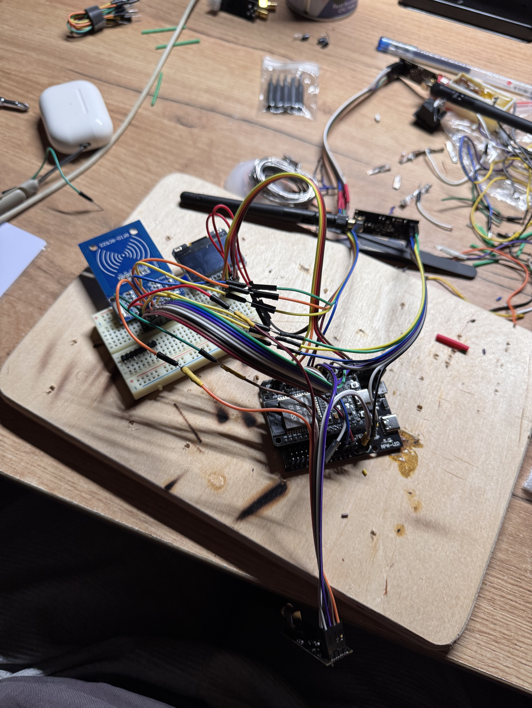
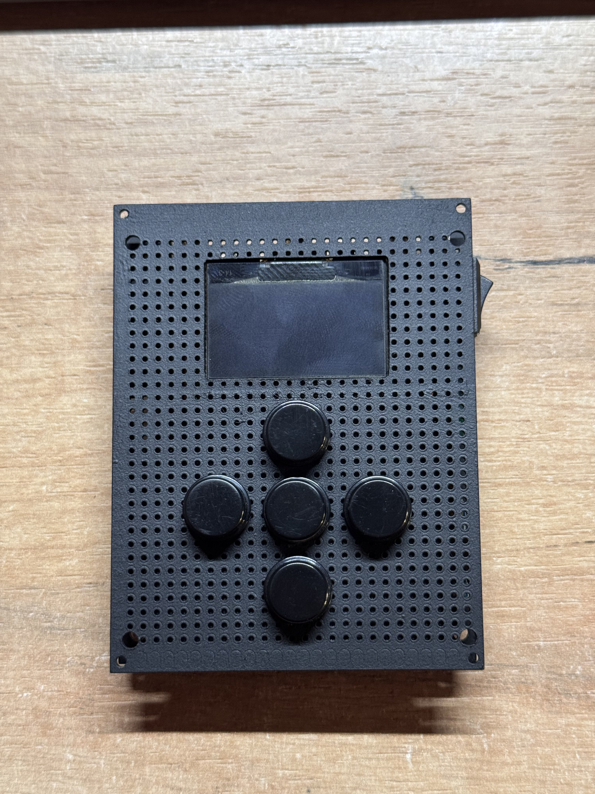
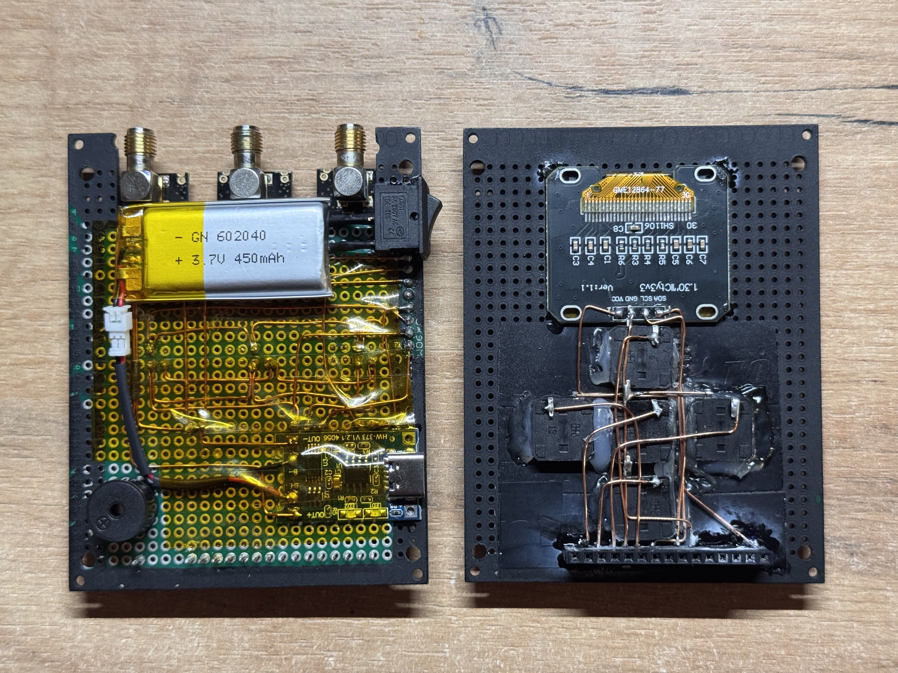
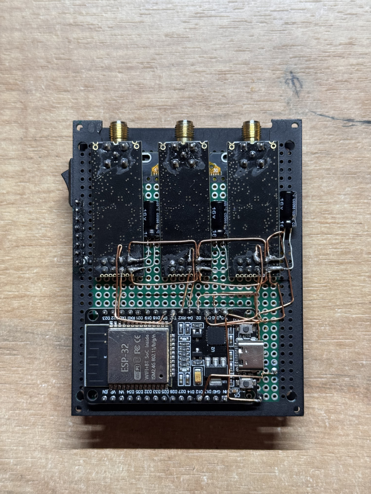
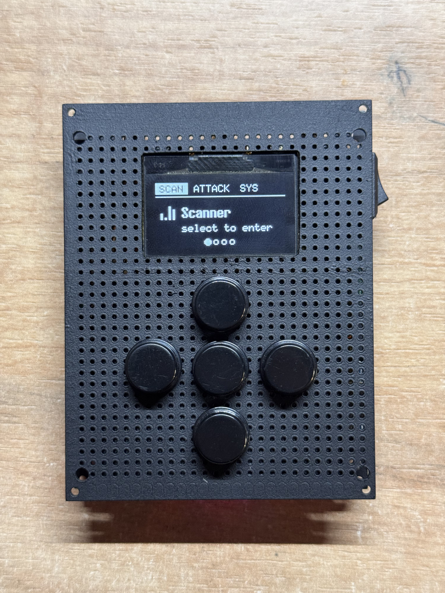
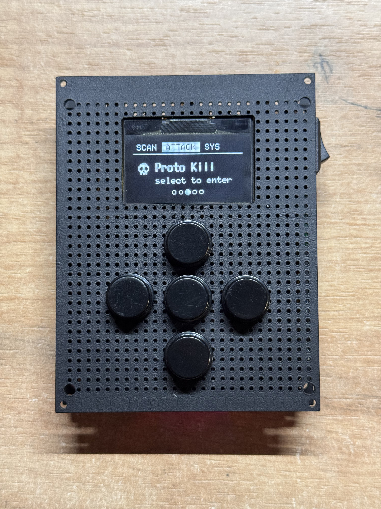
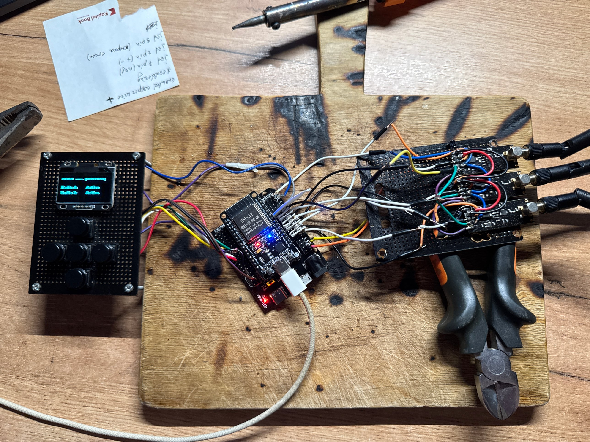
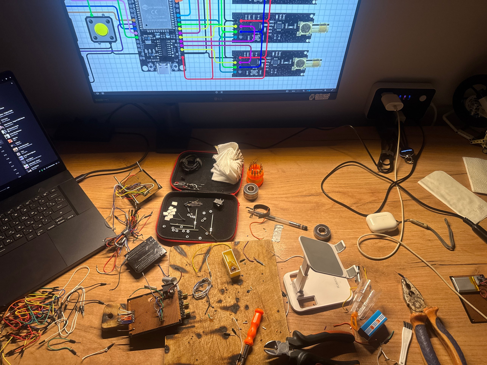

# 📡 ESP32 Multi-Radio Hardware Platform — Embedded Systems Build

> A hands-on hardware project exploring embedded systems design: custom PCB fabrication, multi-radio hardware integration, battery power management, and on-device UI — built from the ground up and iterated through several hardware revisions.

---

<p align="center">
  
  
</p>

---

## 🔧 What This Is

This project is a custom embedded hardware platform built around an ESP32 microcontroller with multiple radio modules, a dedicated OLED display, and a physical button interface — designed, soldered, and iterated entirely by hand. It's a personal electronics/embedded-systems build used to practice PCB layout, power design, firmware architecture, and enclosure design.

---

## ⚙️ Hardware Overview

| Component | Role |
|---|---|
| **ESP32** | Main microcontroller — Wi-Fi + Bluetooth capable SoC |
| **NRF24L01+ × 3** | Parallel 2.4 GHz radio modules |
| **OLED Display (SH1106 128×64)** | On-device menu, status, and live feedback |
| **Physical Buttons (×5)** | On-device navigation without a serial/PC connection |
| **Piezo Buzzer** | Audio feedback for state changes and alerts |
| **LiPo Battery + Charge Circuit** | Cableless, portable power |
| **470µF / 16V Capacitor** | Power-rail smoothing for stable operation under load |
| **Custom Etched/Perf Copper PCB** | Replaces the original point-to-point jumper wiring for a slimmer build |

---

## 🚀 Version History & Upgrades

This build has gone through a complete redesign from the original prototype. Key changes in this revision:

1. **Reliability pass** — cleaned up power and signal wiring issues from the original prototype for more consistent operation.
2. **470µF / 16V capacitor** added to the power rail to smooth voltage dips under load.
3. **Battery-powered, cableless operation** — a LiPo pouch cell replaces the original wall-powered/cabled setup.
4. **Redesigned UI** — new OLED menu layout and button interface for on-device navigation.
5. **Buzzer added** — audio feedback for mode/state changes.
6. **Custom copper PCB** — hand-etched/perfboard circuit replaces loose jumper wiring, enabling a much slimmer enclosure than the original cabled, thick-case build.
7. **Complete internal redesign** — component layout, wiring routing, and board stacking were rebuilt from scratch rather than patched.

---

## 🛠️ Tech Stack & Concepts

```
Hardware       ESP32 · NRF24L01+ (×3) · OLED SH1106 128×64 · Custom etched/perf PCB
Power          LiPo battery + charge circuit · 470µF/16V smoothing capacitor
Firmware       Embedded C/C++ · Arduino framework · SPI bus management · EEPROM persistence
UI/UX          OLED menu system · 5-button navigation · buzzer feedback
Concepts       PCB design & etching · Power regulation · Embedded UI design · Enclosure/form-factor design
```

---

## 🔬 Build Notes

### SPI Bus

| Signal | ESP32 GPIO |
|---|---|
| SCK | GPIO 18 |
| MISO | GPIO 19 |
| MOSI | GPIO 23 |

### OLED Display (SH1106) — I2C

| Signal | ESP32 GPIO |
|---|---|
| VCC | 3.3V |
| GND | GND |
| SCL | GPIO 22 |
| SDA | GPIO 21 |

### Buttons

| GPIO | Function |
|---|---|
| GPIO 25 | Back / Prev |
| GPIO 26 | Up / Toggle |
| GPIO 27 | Select / Next |
| GPIO 32 | Main select |
| GPIO 33 | Down |

---

## 📸 Build Process

<p align="center">
  
  
  
  
  
  
</p>

---

## 📚 References & Further Reading

- [ESP32 Technical Reference Manual](https://www.espressif.com/sites/default/files/documentation/esp32_technical_reference_manual_en.pdf)
- [NRF24L01+ Product Specification](https://www.sparkfun.com/datasheets/Components/SMD/nRF24L01Pluss_Preliminary_Product_Specification_v1_0.pdf)

---

## 👤 Author

Built by **Tunar Khankishiyev** — hardware hacker, embedded systems enthusiast.

- GitHub: [@tunarkhankishiyev](https://github.com/tunarkhankishiyev)
- LinkedIn: [tunar-xankisiyev-154a74328](https://linkedin.com/in/tunar-xankisiyev-154a74328)

---

*Built for learning. Shared for the community.*
